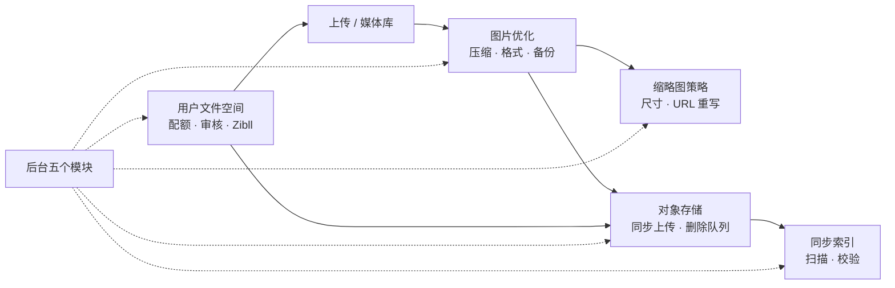

<div align="center">

# 🌸 樱花工具箱

**把 WordPress 媒体处理拆成可组合的模块**

图片压缩 · 缩略图治理 · S3 对象存储 · 同步索引 · 用户文件空间

[](https://github.com/gongjing666/sakura-tools/releases/latest)
[](https://github.com/gongjing666/sakura-tools/actions/workflows/tests.yml)
[](https://github.com/gongjing666/sakura-tools/actions/workflows/phpstan.yml)


[](LICENSE)

[功能](#功能) · [架构](#架构一览) · [安装](#安装) · [快速开始](#快速开始) · [后台导航](#后台导航) · [文档](#文档) · [开发](#开发)

</div>

> **樱花工具箱（sakura-tools）** 是一个运行在你自己 WordPress 里的媒体工具箱：在站点内完成图片压缩与格式转换，按需关闭多余缩略图，把媒体同步到自有 S3 兼容存储，并给投稿者提供带容量配额与审核流程的文件空间。功能按模块拆分，不需要的模块可以保持关闭。

## 为什么是模块化

樱花工具箱把媒体处理拆成五个子系统。每个子系统有自己的设置、数据表与失败处理路径，可以独立启用：

- **图片优化**：上传时压缩，或转成 WebP / AVIF；质量、尺寸、体积上限可控；处理前可备份原图。
- **缩略图**：决定生成哪些尺寸，给缩略图地址加尺寸参数，并让列表、侧栏、正文使用不同尺寸。
- **对象存储**：把附件同步到 Cloudflare R2、MinIO 等 S3 兼容服务，处理删除补偿与上传指标。
- **同步索引**：扫描本地与远端对象，维护可断点续跑的索引、动作队列与校验结果。
- **用户文件空间**：给投稿者提供虚拟文件夹、容量配额、上传权限和删除审核。

所以可以只开图片压缩，不启用云存储；也可以只用文件空间，不改变现有图片处理方式。后台按「系统设置、图片优化、对象存储、文件空间、子比增强」五个模块组织；1.29.0 起 16 个页面的内容区全部是 React 岛。

**适合这些场景**

- 图片量大，想自己掌控压缩质量、格式与备份，而不是把原图交给第三方图片服务。
- 使用 Cloudflare R2、MinIO 或国内 S3 兼容存储，希望媒体库与自有桶保持一致。
- 使用 Zibll 主题，需要给投稿者分配文件空间、配额和删除审核。
- 需要长期维护，希望有代码结构文档、静态分析与测试护栏的开发者。

## 最近更新

- **1.29.0** — 后台 16 个页面的内容区全部迁为 React 岛（13 个 bundle）：顶栏、页签条、页头与首帧仍由 PHP 输出，内容区由 `*_Payload` + bootstrap JSON 挂载；旧 PHP 视图和 `assets/ui/js/pages/*.js` 只在 bundle 不可读时回退，正常请求不再下载旧页脚本。对象存储五页（连接、同步中心、删除队列、链接改写、费用估算）、文件空间五页（样式与策略、用户容量、审核与执行、最近操作、子比专属）与子比增强「性能优化」完成迁岛；同步中心数字实时派生、删除队列完成态/实时进度、链接改写作用域筛选与费用估算保留。顺带补回汽水进度条气泡注入器、修复风险开关取消后未恢复原值，并移除 1.28.8 短暂上线的「文件空间 → 媒体管理」页签。不新增表结构，不改既有 option 键、钩子语义与数据格式；升级无需手工迁移。
- **1.28.8** — 新增「子比增强」模块与授权缓存：主题的授权校验结果可缓存，之后只读页面请求跳过主题那次远程校验；写操作、AJAX/REST/XML-RPC、登录与 cron 仍跑真实校验，主题升级、换域名或换授权会立即失效。同期加入「文件空间 → 媒体管理」页签与共享 `Takedown` 服务，媒体库批量下架与后台走同一份判据、审计与通知（该页签在 1.29.0 移除，媒体库仍是唯一下架入口）。
- **1.28.3** — 存储生命周期十九条规则（R1–R19）全部落地并写进 `docs/开发规则/07-S3存储生命周期.md`。第一次成功上传后绑定存储身份（厂商 / 桶 / 端点 / 地域 / 云端路径），之后改任一项即视为换桶，服务端直接拒绝并返回 `error=locked`；高风险锁定（上传后删本地）想换桶只能全部删除后重来。**换桶之后同步中心会封存**，只有跑完一次完整核对才解锁——期间拦下所有「会按旧索引去向桶里写或删」的动作（刷新差异、继续核对、重试失败、批量上传/下载/删除），三个端点同时返回 409。切换当场弹插件弹窗说明三件事，不再只有左下角一行提示、也不用等刷新看顶部红字。顺带修了「开始完整核对」其实一直发增量扫描（自 1.22.8 起就没真正全量过）、渲染附件 URL 时每次写库、对账索引批量写入的占位符错位、`wp sakura-sync scan --full` 被 WP-CLI 拒绝，以及桶身份五套定义各自为政（现在收敛成 `Bucket_Identity` + `Bucket_Confirmation`，索引改按桶分区，Schema 1.9.0 自动迁移）。缩略图能力探测不再联网。
- **1.28.2** — 存储配置操作规范化。切服务商保存不再覆盖原配置（服务商一变就新建一份，前端把「另存为新配置」勾上并锁定并说明原因）；换桶后已上传附件的 URL 会按同步索引自愈到新域名，切回去也会跟着回来，同步时间不变；腾讯云桶名不再被账号级 APPID 挤成 `sakura-c…4331`，只显示自定义部分；同一存储桶的两份配置不再互相判为换了桶；保存非在用配置不再把活动凭据写成明文；连接表单拒绝空桶名。「启用 S3 存储」从连接设置卡移到已保存的配置卡片上——点非活动卡片即切换并启用，再点当前卡片即关闭但保留配置，走 AJAX 就地重绘；每张卡片新增「连接测试」按钮，不切配置也能验证它是否还活着；卡片底部两个按钮等分两列，静止态就有边框。详见 [readme.txt](readme.txt) 的 changelog。
- **1.28.1** — 去掉一条已经不再成立的缩略图警告。连接页在 1.28.0 已移除对象 ACL 控件，但旧配置里的 private 仍会触发「访客会收到 403」提示；实际可见性由存储空间策略 / CDN 决定，现在不再显示该警告。只是移除提示，不改上传与已有对象。
- **1.28.0** — 对象存储多了两个页面。**链接改写**把数据库里旧的附件域名批量换成新域名（比如缤纷云 `bf.nboke.com` → 多吉云 `doge.nboke.com`），默认只扫文章与主题数据，插件自己的表要显式勾选；每行写前留原值，配回滚账本，改写后又被手改的行会被标成冲突并跳过。**费用估算**按存储量、流量、请求、图片处理和命中率，对多吉云、缤纷云、阿里云、腾讯云、七牛、又拍、百度、Cloudflare R2、Backblaze B2 与 MinIO 逐项算月账单，单价是内置公开价，不联网也不读厂商账单。同时把连接设置卡收敛成一张全宽卡：取消基础/高级折叠，移除会误导人的「文件访问权限（对象 ACL）」；多吉云/COS 的批量删除与分片 ETag 补了兼容兜底。PHPCS 的 37 条 warning 一并清零。详见 [readme.txt](readme.txt) 的 changelog。
- **1.27.6** — 连接失败终于说清原因。S3「测试连接」以前无论什么错都提示「请检查服务商、地域、Endpoint、存储桶和凭据」；现在先 `headBucket`、失败再 `listObjectsV2` 取回带 XML 的错误码，直接告诉你 `InvalidAccessKeyId（HTTP 403）` 还是端点填成了管理 API。多吉云这条线补齐：填存储空间名称即可反查 `s3Bucket` / `s3Endpoint`，缩略图走命名样式（`/720wm`）或 `imageView2`；保存配置改为原地更新，不再偷偷新建一份。同步中心的裸文件名搜索修好了，并新增按需预览。媒体库的卡片与列表缩略图改走云存储，SVG/GIF 不再被拼样式后缀与转成静态图。顺带修掉后台通知条冒充页面根导致整页按钮失效（688px 空白带）与存储页「最后错误」只占半行的问题。详见 [readme.txt](readme.txt) 的 changelog。
- **1.27.5** — 后台切页不再「糊一下」。WordPress 7.0 起给整个后台启用了跨文档 View Transitions，每次点模块或页签都把新旧两页整页交叉淡化 250ms；本插件后台是密集表格与卡片，两层半透明叠在一起就是文字互相穿透。现在用 `@view-transition { navigation: none }` 退出这套过渡，改由自己控制：新文档硬切，只有主内容列 180ms 淡入并上浮 6px，模块切换条、页签条与侧边栏完全不参与动画。顺带更快——命名为 `view-transition-name` 的元素会让浏览器多拍快照并单独分组渲染，实测净增约 15ms；完全不快照反而比默认过渡快约 30ms（点击到 load 完成：456 → 422ms 均值）。另加点击即时反馈：WordPress 引导一次后台请求约 300ms，这段时间页面停在旧内容上像没点中，现在点击同一帧顶部亮起 2px 樱色扫光条，新文档出来自然消失，`prefers-reduced-motion` 下改为常亮不扫光。
- **1.27.4** — 卸载残留清理：勾选「删除数据」后仍留下外观设置、两把命名固定的锁、`sakura_imgopt_lock_*` 前缀锁与两条 usermeta；transient 扫描扩到 `sakura_imgopt_` 与 `sufm_` 两个命名空间（含 timeout 条目）。顺带修掉停用后 `sakura_imgopt_sync_calibrate` / `_now` 仍留在定时任务里的问题（这两个由校准器自己排期，不走激活流程）。
- **1.27.3** — 「空间套餐」图标字段从 150px 的虚线方块改成与输入框同规格的 chip（38px 高、同边框同圆角，缩略图 28×28），URL 输入框加 `max-width: 560px`。顺带修 `.btn` 的 `display` 覆盖浏览器默认 `[hidden]` 规则、导致被隐藏的「移除」按钮仍占 30px 高的问题。
- **1.27.2** — 提示弹窗从「全屏遮罩 + 居中卡」改成无遮罩卡片：页面照常可滚可点可读，打开不再把 body 改成 `position: fixed`（那会让文档当帧塌成视口高、整页重排，滚动条消失又让视口变宽 15px 抖一下）；自动弹窗不再延迟 180/220ms 排队，改为脚本执行时同步打开；动效只留淡入淡出。二次确认与媒体预览仍用原生 `<dialog>` + `showModal()`。
- **1.27.1** — 修 1.27.0 的内联 `grid-row`/`grid-column` 压过样式表的问题：改用 `--g-card-row`/`--g-card-col`/`--g-card-span` 三个自定义属性由 `components.css` 读取，手机端才恢复单列。同行卡片改为等高（`align-items: stretch`），并按阅读顺序重排消除半满行，现在 13 个页面每一行都恰好填满。
- **1.27.0** — 移除卡片拖拽布局引擎：后台卡片改为服务端确定的静态排布，行号、起始列与跨列数由 `Layout::PAGES` 声明，浏览器首帧即最终形态。一并删掉 `layout.js`、`layout.css`（约 2600 行）、右侧「布局修改」工具栏、拖拽缩放、46px 预留留白与按用户存的布局元数据。卡片排布从此是出厂设置。
- **1.26.0** — 配色重做：整栈换成樱色令牌（暖樱白画布 + 纯 CSS 生成的樱尘点阵，不用任何图片或 SVG），主按钮为深樱 `#9d3452`，所有文字/底色组合实测对比度 ≥4.5:1。顺手修掉三个真实缺陷：百分比进度条一直是 0 宽（span 行内元素忽略 width）、最强那层樱雾在长页面上被推到视口外、统计页两处仍是旧石墨色。反馈统一走新增的 `UI::modal()`，保存与检测结果不再出现「弹窗和原生 notice 各说一遍」。

[完整更新日志](readme.txt) · [所有 Release](https://github.com/gongjing666/sakura-tools/releases)

## 功能

| 能力 | 关键点 | 后台入口 |
| --- | --- | --- |
| **图片优化** | 上传压缩；保持原格式或转 WebP / AVIF；质量、最大边长与体积上限；原图备份与单张还原；动图跳过；媒体库批量优化与进度 | 图片优化 → 优化规则 / 备份还原 / 统计 |
| **缩略图** | 禁用不需要的尺寸；给缩略图地址加尺寸参数；列表、侧栏、正文可分别指定 | 图片优化 → 缩略图 |
| **对象存储** | 10 家 S3 兼容服务；附件创建时同步上传；删除失败进补偿队列；Prometheus 指标与 webhook 告警 | 对象存储 → 连接配置 / 同步中心 / 删除队列 |
| **存储工具** | 附件链接批量改写（带账本与回滚）；10 家云存储费用估算；连接参数与兼容性说明集中在一张卡 | 对象存储 → 链接改写 / 费用估算 |
| **同步索引** | 本地与远端扫描；断点续跑；MD5 / ETag 校验；动作队列与结果核对 | 对象存储 → 同步中心 |
| **用户文件空间** | 虚拟文件夹；单文件、每日、用户与站点配额；删除申请 → 审核 → 执行；媒体库归属与容量 | 文件空间 → 样式与策略 / 用户容量 / 审核与执行 / 最近操作 / 子比专属 |
| **子比增强** | 授权校验缓存（只读请求跳过主题远程校验）；性能相关开关与复验状态 | 子比增强 → 性能优化 |
| **编辑页文件面板** | 拖到正文插入；右键插入；Shift / Ctrl 多选；批量操作条 | Zibll 发帖 / 编辑页 |

几个不显眼但重要的行为：

- **先备份，再处理**：原图备份可配置保留时间与容量上限，支持单张还原；清空备份后已优化图片无法回滚。
- **没有收益就不写入**：压缩结果没有变小时保留原图，避免“越压越大”。
- **删除不是一键**：用户只能提交删除申请，管理员审核后还要在后台确认执行；执行前会重新校验锁、预览哈希与停止标记。
- **配额按字节、界面按 MB**：数据库、REST 与配额计算使用字节，后台容量字段统一用 MB 输入和展示。

## 架构一览



这是一条典型链路，不代表模块必须一起启用。代码按职责分层：

| 层 | 位置 | 职责 |
| --- | --- | --- |
| 入口与生命周期 | `sakura-tools.php`、`uninstall.php` | 常量、自动加载、启用 / 停用 / 卸载 |
| 组合根 | `src/Plugin.php` | 创建仓储与模块，统一交给 `Hook_Loader` 注册 |
| 业务子系统 | `src/Image`、`src/Thumbnail`、`src/S3`、`src/Sync`、`src/UserFiles`、`src/Zibll` | 图片、缩略图、对象存储、索引、文件空间、子比增强 |
| 后台信息架构 | `src/Admin/Registry.php`、`src/Admin/Menu.php` | 五个模块、16 个页签、权限与 renderer 分发 |
| 后台 UI 栈 | `src/Admin/UI.php`、`src/Admin/UI/`、`src/Admin/Page_Assets.php`、`assets/ui/`、`assets/ui/src/` | 页面骨架、卡片与控件、外观令牌、按页加载资源；16 页内容区由 React 岛渲染 |
| 兼容层 | `includes/`、`includes/views/` | 旧实现与后台视图/岛挂载壳，仍由启动流程加载，不能盲删；bundle 不可读时回退 |

<details>
<summary><strong>代码规模与仓库结构（1.29.0）</strong></summary>

| 指标 | 数值 |
| --- | --- |
| 生产 PHP | 273 文件 / 94,417 行 |
| 类与接口 | 247 |
| 注册钩子 | 246 |
| 自定义表 | 25 |
| 后台模块 | 5（16 个页签，13 个 React bundle） |
| 后台 CSS/JS | 131 文件 / 34,905 行（含 `assets/ui/src/` 与提交进仓库的 `assets/ui/dist/`） |
| 测试 | 122 文件 / 19,671 行；918 tests / 3,889 assertions / 6 skipped |

```text
sakura-tools/
├── sakura-tools.php          # 插件入口：常量、autoload、启动
├── uninstall.php             # 卸载入口
├── src/
│   ├── Plugin.php            # 组合根
│   ├── Admin/                # 后台信息架构、菜单、UI 内核与资源加载
│   ├── Image/                # 图片处理
│   ├── Thumbnail/            # 缩略图策略
│   ├── S3/                   # 对象存储
│   ├── Sync/                 # 同步索引
│   ├── UserFiles/            # 用户文件空间
│   └── Zibll/                # 子比主题增强（授权缓存、性能优化）
├── includes/                 # 兼容层与后台视图（仍承重）
├── assets/
│   ├── ui/                   # 后台唯一样式栈：令牌、组件、页面 CSS、dist bundle
│   ├── ui/src/               # React 岛源码（16 个页面，13 个入口）
│   ├── css/ js/              # 前台与媒体库资源
│   └── wp-media/             # 媒体库扩展样式
├── docs/                     # 代码结构文档、UI 规则与静态图谱
├── tests/                    # PHPUnit
└── vendor/s3/                # 内置、命名空间隔离的 AWS SDK
```

</details>

## 环境要求

| 项目 | 要求 |
| --- | --- |
| WordPress | 6.4 或更高 |
| PHP | 8.2 或更高 |
| 图像处理 | 优先 Imagick，缺失时回退 GD；输出 AVIF 需要服务器支持，不支持时会明确失败 |
| 数据库 | MySQL / MariaDB，使用 InnoDB |
| 对象存储 | 可选；任意 S3 兼容服务，内置 10 家预设 |
| 主题 | 可选；Zibll 主题可获得用户中心与写作页的完整集成 |
| 多站点 | 支持；每个站点独立设置、统计与上传目录 |
| WP-CLI | 可选；用于扫描、校验、迁移与授权审计 |

## 安装

### 从 Release 安装（推荐）

1. 打开 [Releases](https://github.com/gongjing666/sakura-tools/releases/latest)，下载 `sakura-tools-<版本>.zip`。
2. WordPress 后台 → 插件 → 安装插件 → 上传插件，选择 zip；或解压到 `wp-content/plugins/`。
3. 启用「樱花工具箱」。
4. 打开「樱花工具箱 → 系统 → 环境自检」，确认 PHP 版本、Imagick / GD、数据库与计划任务状态。

升级前建议备份数据库与 `wp-content/uploads/`。Release 包已经包含 `vendor/s3/` 运行时依赖，不包含开发文件与测试。

### 从源码安装

```bash
cd wp-content/plugins
git clone https://github.com/gongjing666/sakura-tools.git
```

然后在后台启用。源码目录包含 `tests/`、`docs/` 等开发文件；生产环境优先使用 Release 包。

## 快速开始

| 顺序 | 页面 | 建议动作 |
| --- | --- | --- |
| 1 | 系统设置 → 环境自检 | 确认 PHP、Imagick / GD、数据库与计划任务；有红色项先处理 |
| 2 | 图片优化 → 优化规则 | 开启上传压缩，选择保持原格式或 WebP / AVIF，设置质量与尺寸上限 |
| 3 | 图片优化 → 缩略图 | 关掉不需要的尺寸；需要 URL 尺寸参数时再开启重写 |
| 4 | 图片优化 → 备份还原 | 设置保留时间与容量上限，点一次「检测是否可被公网访问」 |
| 5 | 对象存储 → 连接配置 | 选择服务商，填写 bucket、endpoint 与密钥，执行连接测试 |
| 6 | 对象存储 → 同步中心 | 首次扫描并核对索引；后续按需执行校验与动作队列 |
| 7 | 文件空间 → 样式与策略 / 用户容量 | 打开入口，设置配额、上传策略与删除审核 |

只做图片优化时，完成 1–4 即可；对象存储与文件空间都是可选模块。文件空间与 Zibll 集成时入口更完整，也可以通过 `[sufm_files]` 短代码放到普通页面。

## 后台导航

| 模块 | 页面 |
| --- | --- |
| 系统设置 | 环境自检 |
| 图片优化 | 优化规则、缩略图、备份还原、统计 |
| 对象存储 | 连接配置、同步中心、删除队列、链接改写、费用估算 |
| 文件空间 | 样式与策略、用户容量、审核与执行、最近操作、子比专属（Zibll 可用时） |
| 子比增强 | 性能优化（仅 Zibll 主题可用） |

「文件空间」需要审核或执行权限；「子比专属」只在主题可用时出现。需要命令行维护时：

| 命令 | 用途 |
| --- | --- |
| `wp sakura-sync` | 扫描、索引、校验与对账 |
| `wp sakura-thumb` | 缩略图探测与批量处理 |
| `wp sakura-s3` | 连接测试、迁移与删除队列处理 |
| `wp sufm` | 文件空间诊断、对账、历史授权审计与导入 |

具体参数用 `wp help <command>` 查看。

## 用户文件空间

把投稿者的文件从“直接丢进媒体库”变成有归属、有配额、有审核的受管空间。

### 入口

- **短代码**：`[sufm_files]`，可以放在用户中心页或普通页面。
- **Zibll 用户中心**：开启后增加文件页签，展示容量、文件与申请状态。
- **Zibll 写作页**：发帖 / 编辑页右侧文件面板，支持拖到正文插入、右键插入与快捷多选。

### 权限与配额

- 文件按所有者隔离；普通用户只能管理自己的文件，管理员通过「用户容量」与「审核与执行」处理全站。
- 配额覆盖单文件上限、每日上传量、用户容量与站点总预算；后台按 MB 展示，底层按字节计算。
- 删除必须走「申请 → 审核 → 后台确认执行」；执行前重新校验锁、预览哈希与停止标记，避免误删正在使用或已变化的文件。
- 媒体库可以直接查看文件归属、容量占用与申请状态。

### 空间扩容

- 扩容套餐分现金与积分两种；现金默认走余额，订单通过 Zibll 主题的订单与钱包钩子完成。
- **默认只启用余额**。外部支付渠道必须在「文件空间 → 子比专属 → 支付方式」显式勾选后才会出现在前台；未勾选的渠道不能通过过滤器重新启用。
- 积分入口有独立开关；关闭后前台隐藏入口，兑换请求也会被拒绝。
- 退款失败（`refund_failed`）不会自动重试。这是刻意保留的人工边界：主题钱包流水没有唯一键，自动重试可能重复退款，需要在订单与用户余额之间人工核对后处理。

## 对象存储与同步

支持 Cloudflare R2、MinIO、多吉云、阿里云 OSS、腾讯云 COS、七牛云 KODO、又拍云 USS、百度云 BOS、Backblaze B2、缤纷云。所有服务走 S3 兼容 API。

- **凭据加密**：Access Key 与 Secret 以 `sio1s:` 前缀的密文存入数据库，页面不显示明文；更换加密密钥或站点安全密钥后需要重新填写。
- **同请求上传**：附件创建时同步上传，不依赖后台队列。成功与失败都会写入上传事件表；远端删除失败进入 `sio_s3_deletes` 补偿队列。
- **同步中心**：扫描本地与远端对象，支持断点续跑、动作队列、MD5 / ETag 校验与结果核对；大库可以分页处理。
- **可观测性**：提供 Prometheus 指标与 webhook 告警；上传事件表按天聚合成功、失败与耗时。
- **兼容性**：保留与 S3 Uploads 1.3.1 的路径和元数据兼容；内置 AWS SDK 使用独立命名空间，避免与其他插件冲突。

## 安全与数据边界

> [!WARNING]
> **文件空间不是私有网盘。** 上传成功后返回的是标准附件地址；云存储接管后会变成存储 / CDN 直链。文件名虽然随机，但**拿到链接的人不需要登录就能访问**。不要把合同、证件、内部资料放进去；需要真正私有的文件，请使用自建存储并自行配置鉴权，或不要开启「上传后删除本地文件」。

> [!IMPORTANT]
> **启用云存储并删除本地副本后，主题的付费附件校验可能失效。** Zibll 等主题的下载按钮先校验购买状态，再解析本地 `uploads/` 路径；文件只剩远端直链时，主题会退化为 302 跳转，购买校验可能被绕过。插件目前没有接管这个跳转。需要这层保护时，请保留本地文件，或在主题之前自行代理 / 签发短时预签名地址。

其他部署边界：

- **备份目录**：Apache 会读取插件写入的 `.htaccess`；Nginx、OpenResty、IIS、Caddy 与 PHP 内置服务器不会。使用这些服务器时请在站点配置中拒绝备份目录：

  ```nginx
  location ^~ /wp-content/uploads/sakura-imgopt-backup/ {
      deny all;
  }
  ```

  部署后用「备份还原 → 检测是否可被公网访问」确认。

- **卸载**：同步索引与队列表总会删除；设置、云存储密钥、统计与备份文件默认保留。只有在「备份还原 → 自动清理策略」开启「卸载时删除数据」，才会逐站删除这些持久数据。
- **多站点**：每个站点独立保存设置、统计与上传目录；卸载按站点分别处理。
- **升级**：涉及数据库或对象存储的版本，升级前先备份数据库与 `uploads/`，再在测试环境验证扫描与删除路径。

## 文档

完整索引见 [docs/README.md](docs/README.md)。最常用的三个入口：

| 文档 | 内容 |
| --- | --- |
| [开发规则索引](docs/开发规则/00-索引.md) | **改代码从这里开始**：五分钟上手路径、按任务找文档、十条铁律 |
| [代码结构文档](docs/sakura-tools-代码结构-1.28.3.md) | 文件树、类职责、依赖矩阵、钩子分布；生成物停在 1.28.3，1.28.4–1.29.0 新增类以 `src/` 为准 |
| [DECISIONS.md](DECISIONS.md) | 关键设计取舍与已知边界，记录「为什么」而不是「现在有什么」 |
| [CONTRIBUTING.md](CONTRIBUTING.md) | 环境、提交前必跑的命令、提交信息与 PR 要求 |

十四篇开发规则各自覆盖一块，边界不重叠：

| 文档 | 覆盖 |
| --- | --- |
| [00 索引](docs/开发规则/00-索引.md) | 五分钟上手、按任务找文档、十条铁律、文档维护约定 |
| [01 架构与装配](docs/开发规则/01-架构与装配.md) | 目录、autoloader、启动顺序、`Module` 契约、模块装配、路由、生命周期 |
| [02 新增功能](docs/开发规则/02-新增功能.md) | 改动分类、契约先行、服务类、AJAX/REST、React 岛新页面九处必改、命名、i18n、测试 |
| [03 后台 UI](docs/开发规则/03-后台UI.md) | 样式分层、设计令牌、间距、边框、页头、弹窗、控件、React 岛接入、移动端、验收清单 |
| [04 数据与存储](docs/开发规则/04-数据与存储.md) | option、`Card_Form`、建表、迁移、卸载、文件、队列、多站点 |
| [05 测试与质量](docs/开发规则/05-测试与质量.md) | PHPUnit / PHPStan / PHPCS / PHPCompatibility 口径、CI、手工验收 |
| [06 发布流程](docs/开发规则/06-发布流程.md) | 版本号、changelog、门禁、打包、Release、部署、回滚 |
| [07 S3 存储生命周期](docs/开发规则/07-S3存储生命周期.md) | 连接、启用/切换、绑定锁定、删除、R1–R20 与生产验收 |
| [08 OpenList 迁移通道](docs/开发规则/08-OpenList迁移通道.md) | 跨厂商搬桶边界、OpenList API 取证与人工迁移 |
| [09 删除与结算](docs/开发规则/09-删除与结算.md) | 删除顺序、容量退还、媒体库直删、P1–P4 |
| [10 静态资源手册](docs/开发规则/10-静态资源手册.md) | CSS/JS 文件地图、加载顺序、覆盖方式、前台样式坑 |
| [11 违规处置与用户处罚](docs/开发规则/11-违规处置与用户处罚.md) | 下架后处罚、通知、禁上传、期限、撤销、子比小黑屋 |
| [12 React 代码规范](docs/开发规则/12-React代码规范.md) | 岛结构、状态与保存、副作用、Actions、性能、DOM 契约、禁止清单 |
| [13 PHP 代码规范](docs/开发规则/13-PHP代码规范.md) | PHP 8.2–8.4 语法边界、8.4 弃用、向下兼容、自查清单 |

另有两类补充：3D 图谱静态页（[docs/graph-preview/index.html](docs/graph-preview/index.html)，GitHub 不执行页面脚本，克隆后用浏览器打开）；以及 [docs/history/](docs/history/) 里的归档文档（`DEVELOPMENT.md`、1.25.9 / 1.27.5 / 1.27.6 的分析产物、后台 UI 重构方案），**开头的声明都写着「不代表现状」**，只管追溯「当时为什么这么做」。

代码规模、节点数与钩子数会随版本变化；文档里的数字都以当轮扫描结果为准。

## 开发

### 本地检查

```bash
composer install
npm ci                 # 改过 assets/ui/src 时需要
composer test
composer phpstan
composer lint:strict
composer lint:compat
npm run build          # 重打 13 个 React bundle 并提交 assets/ui/dist/
```

项目使用 PHPUnit 10.5、PHPStan 2.x（level 5）与 WPCS 3.4.1；PHP 语法下限 8.2，生产按 8.4 验证。CI 运行 Tests 与 PHPStan 两个 workflow；提交前至少跑一遍测试、静态分析、代码规范与 PHP 版本兼容检查。当前基线：918 tests / 3,889 assertions / 6 skipped。

### 代码约定

开发规范不在这里重复，按下面的路径查：

- **判断改动落在哪、按什么顺序写** → [02 新增功能](docs/开发规则/02-新增功能.md)
- **启动顺序、`Module` 契约、路由与生命周期** → [01 架构与装配](docs/开发规则/01-架构与装配.md)
- **option / 建表 / 迁移 / 卸载** → [04 数据与存储](docs/开发规则/04-数据与存储.md)
- **测试口径与静态分析红线** → [05 测试与质量](docs/开发规则/05-测试与质量.md)

最常被违反的四条，先记住：

- 新业务代码放 `src/`（PSR-4）；`includes/` 是兼容层，仍在承重，删除前先确认没有运行时引用。
- 模块实现 `register_hooks(Hook_Loader $hooks): void`，构造里不挂钩子；`Admin\Menu` 永远最后装配。
- 新增后台页签要同时改 `src/Admin/Registry.php`（模块与页签）与 `src/Admin/Layout.php` 的 `PAGES`（卡片位置）。
- 新增 cron 要写进 `Deactivation::run()`，新增表 / option 要写进 `Uninstaller` 的清理清单。

## 打包与发布

完整流程（版本号规则、changelog 写法、三关检查、部署与回滚）见 [06 发布流程](docs/开发规则/06-发布流程.md)。**只记一句**：版本号以 `sakura-tools.php` 的 `Version` 为准，必须与 `SAKURA_TOOLS_VERSION`、`readme.txt` 的 `Stable tag` 三处一致，发布前在 `readme.txt` 顶部补对应版本的 changelog。

本地构建（默认当前 HEAD）：

```bash
bin/build-plugin-zip.sh --version 1.29.0 --out dist
```

补建历史版本包：

```bash
bin/build-plugin-zip.sh --ref c8e6b4a --version 1.22.9 --out dist
```

推送到 `main` 后，`.github/workflows/release.yml` 会在插件头、`readme.txt`、打包脚本或 workflow 变化时触发：读取版本号、校验 `Stable tag`，如果对应的 `v<版本>` Release 不存在，就构建插件包并创建标签与 Release；已存在的版本会跳过。如需重建同一版本，先删除对应的 Release 与标签，再重新运行。也可以在 Actions 里手动运行 `Release plugin`。

构建产物包含 `sakura-tools-<版本>.zip` 与同名 `.sha256` 校验文件。包内顶层目录为 `sakura-tools/`，保留运行时依赖 `vendor/s3/`，不包含根 `vendor/`、`tests/`、`docs/`、`.github/`、`bin/`、Composer / PHPCS / PHPStan / PHPUnit 配置和开发文档。

## 许可

[GPL-2.0-or-later](LICENSE)。第三方组件、S3 SDK 的命名空间隔离与 S3 Uploads 兼容说明见 [THIRD-PARTY-NOTICES.md](THIRD-PARTY-NOTICES.md)。

---

<p align="center">问题、建议或使用反馈，欢迎提交 Issue 或 PR。提 PR 前请先看 <a href="CONTRIBUTING.md">CONTRIBUTING.md</a>；安全漏洞请走 <a href="SECURITY.md">SECURITY.md</a> 的私有通道。</p>
